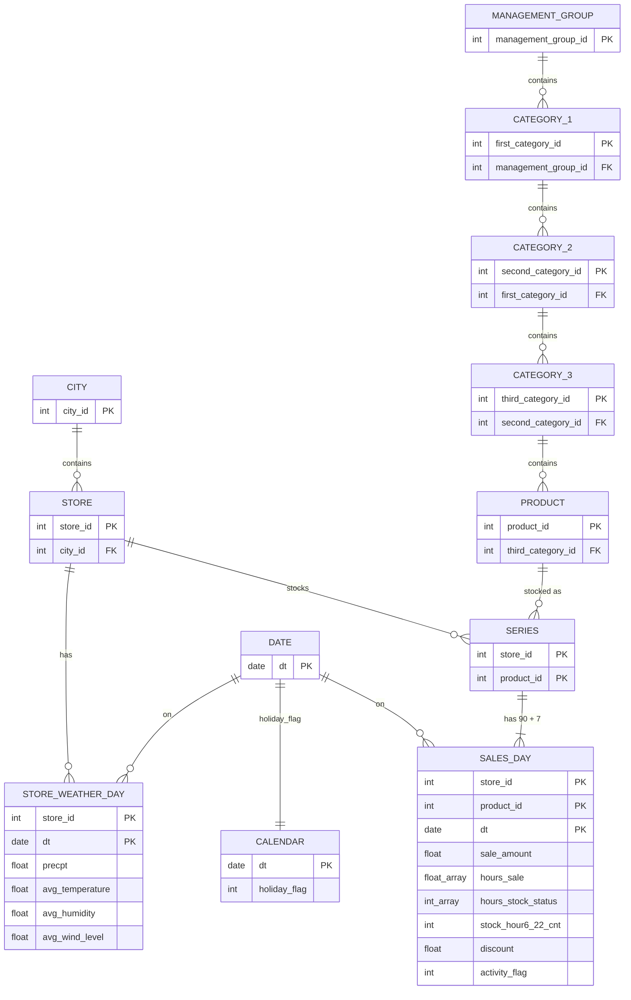

# Data model — FreshRetailNet-50K

This document describes three things:

- **Physical model:** the structure of the data as delivered.
- **Logical model:** the entities and relationships implied by that structure.
- **Analytical model:** the representations this project derives from it.

All facts were checked against Hub revision `c374e85975c82816c495acfa904cc55ab14a47d3`
(official train split) on 2026-11-12. Audit evidence is in [`data_card.md`](data_card.md).

---

## 1. Physical model: one flat table, two splits

The provider ships **one denormalized table**, split by date into two Parquet files with
identical schemas. There are no separate dimension tables. All hierarchy and context attributes
are repeated on every row.

| Split | File | Rows | Dates | Project role |
|---|---|---|---|---|
| `train` | `data/train.parquet` (106 MB) | 4,500,000 | 2024-03-28 → 2024-06-25 (90 days) | fit (76 days) + validation (14 days) |
| `eval` | `data/eval.parquet` (8 MB) | 350,000 | 2024-06-26 → 2024-07-02 (7 days) | **locked final test** |

**Grain:** one row is one `(store_id, product_id, dt)`, which means one store-product series on
one day. Each row holds two 24-element hourly arrays.

### Columns

| # | Column | Type | Group | Description |
|---|---|---|---|---|
| 1 | `city_id` | int64 | location | encoded city |
| 2 | `store_id` | int64 | location / key | encoded store (each store is a warehouse) |
| 3 | `management_group_id` | int64 | product hierarchy | top product level |
| 4 | `first_category_id` | int64 | product hierarchy | category level 1 |
| 5 | `second_category_id` | int64 | product hierarchy | category level 2 |
| 6 | `third_category_id` | int64 | product hierarchy | category level 3 |
| 7 | `product_id` | int64 | product / key | encoded product (perishable SKU) |
| 8 | `dt` | string (`YYYY-MM-DD`) | time / key | calendar date |
| 9 | `sale_amount` | float64 | target | daily sales, normalized ("multiplied by a specific coefficient") |
| 10 | `hours_sale` | list[float64] × 24 | target | hourly sales, normalized; index = hour of day 0–23 |
| 11 | `stock_hour6_22_cnt` | int32 | availability | number of out-of-stock hours in hours **6–21** |
| 12 | `hours_stock_status` | list[int] × 24 | availability | hourly flag: 1 = out of stock, 0 = in stock |
| 13 | `discount` | float64 | promotion | price ratio: 1.0 = full price, 0.9 = 10% off |
| 14 | `holiday_flag` | int32 | calendar | holiday indicator |
| 15 | `activity_flag` | int32 | promotion | promotional activity indicator |
| 16 | `precpt` | float64 | weather | total precipitation (0–42.5) |
| 17 | `avg_temperature` | float64 | weather | average temperature (12.1–30.9) |
| 18 | `avg_humidity` | float64 | weather | average humidity (27.4–100) |
| 19 | `avg_wind_level` | float64 | weather | average wind force (0.97–3.85) |

---

## 2. Logical model: entities and relationships

Normalizing the flat table gives a star schema. **SERIES** (store × product) is the central
modelling unit. **SALES_DAY** is the fact. Weather and holidays are really attributes of
coarser entities that happen to be repeated on every row.



### Cardinalities (train)

| Entity | Count | Relationship facts |
|---|---|---|
| City | 18 | |
| Store | 898 | each store belongs to exactly 1 city |
| Management group | 7 | |
| Category 1 / 2 / 3 | 32 / 84 / 233 | strict tree: each node has exactly 1 parent |
| Product | 865 | each product belongs to exactly 1 level-3 category |
| Series (store × product) | 50,000 | about 6.4% of the 776,770 possible pairs (sparse assortment) |
| Products per store | min 1 · median 50 · max 164 | |
| Stores per product | min 1 · median 10 · max 783 | |
| Days per series | 90 (train) + 7 (eval) | every series has every date; shared calendar, no gaps |

### Where each attribute really lives

Determined by checking whether the attribute ever varies within the candidate key:

| Attribute | True grain | Evidence |
|---|---|---|
| `holiday_flag` | date | 1 distinct value per date across all rows |
| weather (4 fields) | store × date | constant within store-date; up to 268 distinct values within a city-date |
| `discount` | store × product × date | up to 237 distinct values for one product on one date across stores |
| `activity_flag` | store × product × date | varies across products within a store-date |
| `city_id` | store | 1 city per store |
| category ids | product | 1 category path per product |

---

## 3. Semantics and integrity constraints

| Constraint | Status | Enforced by |
|---|---|---|
| `(store_id, product_id, dt)` is unique | holds | audit gate `no_duplicate_keys` |
| `hours_sale` and `hours_stock_status` have length 24 | holds | audit gate `arrays_len_24`; `data.hourly_matrix` raises otherwise |
| `sale_amount == sum(hours_sale)` | holds exactly | audit `daily_vs_hourly_sum` |
| `stock_hour6_22_cnt == sum(hours_stock_status[6:22])` | holds on 100% of rows | audit `cnt_field_match_by_window` |
| `hours_stock_status ∈ {0, 1}` | holds | audit gate `status_binary` |
| sales ≥ 0, no NaN, no nulls in any column | holds | audit gate `no_negative_or_nan_sales`, `null_counts` |
| every series covers every date, no gaps | holds | audit `series_with_date_gaps`, `series_not_sharing_calendar` |
| test dates strictly after train for every series, no shared keys | holds (gap = 1 day) | audit gates `cross.*` |
| store → city and product → category are functions | holds | audit `check_covariates` |
| full category tree is strict | holds | checked ad hoc on 2026-11-12; not yet an automated gate |

### Meaning of the values

- **Sales units.** Values are normalized by an undocumented global coefficient. 99.56% of
  positive hourly values lie on a 0.1 grid, and the rest (0.06, 0.07, …) cluster in two
  management groups. Treated as **continuous normalized units**, not counts.
- **Hour index.** Array position *h* is the hour [h:00, h+1:00). Most sales occur in hours 6–21.
  Night hours have near-zero sales and are often flagged out of stock (33–42%), which looks
  operational rather than a sign of lost demand.
- **Stockout flag.** The flag is not an exact measure of unmet demand. Sales in flagged hours
  are about 18% (first flagged hour) and 8% (later flagged hours) of normal, and 2.9% of flagged
  hours have positive sales. The in-stock hour just before a stockout run sells 2.2× normal: the
  product probably sold out during that hour.
- **What is absent.** No inventory levels, prices, costs, orders, deliveries, lead times or
  lost-sales measurements. Everything on the supply side of the decision twin is synthetic.

---

## 4. Analytical model: what this project derives

### 4.1 Representations

| Representation | Grain | Built by | Use |
|---|---|---|---|
| **Daily wide** (as delivered) | series × day, 24-element arrays | `data.load_split` | storage, daily models, joins |
| **Hourly matrix** | `(n_rows, 24)` NumPy array | `data.hourly_matrix` | vectorized audit and censoring analysis |
| **Hourly long** | series × day × hour (≈ 108M train rows) | `data.to_hourly_long` (lazy) | hourly models; materialized only for subsets |
| **Series panel** | series × time index | planned (Step 2) | state-space models, particle filter replay |

### 4.2 Split roles (`configs/manifests/splits_v1.json`)

```
             2024-03-28 ─────────── 2024-06-11 │ 06-12 ──── 06-25 │ 06-26 ── 07-02
 in-sample   [               fit (76 d)        ][   val (14 d)    ][ test (locked) ]
 series
 (43,883)
 hold-out    [ never used for fitting or tuning; evaluated only for generalization   ]
 series      (90 held-out stores OR 43 held-out products → 6,117 series)
```

`splits.assign_roles(df, manifest)` adds a `role` column (`fit`/`val`) and a `holdout` column
(bool) to train rows. The manifest is digest-protected: `read_manifest` rejects edits, and
`write_manifest` refuses silent overwrites.

### 4.3 Hourly availability classes (planned observation model, hours 6–21)

Derived from `hours_stock_status` at hour *t* and *t+1*:

| Class | Rule | Interpretation | Default likelihood treatment |
|---|---|---|---|
| **A**: available | flag(t)=0, flag(t+1)=0 | fully in stock | uncensored |
| **P-pre**: depletion hour | flag(t)=0, flag(t+1)=1 | likely sold out during the hour | right-censored at observed sales |
| **P-first**: first flagged hour | flag(t)=1, flag(t−1)=0 | partial availability or flag noise | right-censored, uncertain availability fraction |
| **U**: unavailable | flag(t)=1, flag(t−1)=1 | out of stock | excluded (sensitivity: censored, flag-noise rates) |
| **N**: night | t ∉ 6–21 | low-rate operating regime | modelled separately; flags not treated as censoring |

Each treatment is varied in a pre-declared sensitivity analysis (see `data_card.md`).

### 4.4 Modelling hierarchy

The nesting supports partial pooling. The planned random effects follow both trees:

```
log μ = α_management_group → category_1 → category_2 → category_3 → product (u_i)
      + city → store (v_s)
      + latent state z_{store,product,t}
      + β · [discount, activity, holiday, lagged weather] + seasonal(hour, weekday)
```

The sparse assortment (median 10 stores per product, 50 products per store) is why pooling is
needed. Many series have little data of their own, but their product and store relatives do.

### 4.5 Information available at decision time

| Feature | Available at forecast origin? | Rule |
|---|---|---|
| past sales and stock flags | yes | strictly before the forecast origin |
| `discount`, `activity_flag` for the target day | assumed planned in advance | declared assumption; ablated |
| `holiday_flag` | yes | calendar is known ahead |
| weather for the target day | **no** (observed after the fact) | lagged values or a declared forecast proxy only |
| current-hour sales or flags | no | never used as features for that hour |

---

## 5. Synthetic supply-side entities (not in the data)

For the decision twin (Steps 7–9), these are generated, versioned and disclosed as research
scenarios:

| Entity | Attributes |
|---|---|
| Supplier | lead-time distribution (1–7 days), reliability, order minimums |
| Inventory position | on hand by age (perishable), pipeline orders with due dates, capacity |
| Cost structure | fixed and variable ordering, holding, shortage penalty, spoilage |
| Scenario | demand trajectory source (held-out data or a synthetic generator), seed, constraints, budget |

Demand trajectories come from the forecasting pipeline in normalized units. They are never
presented as retailer quantities.
